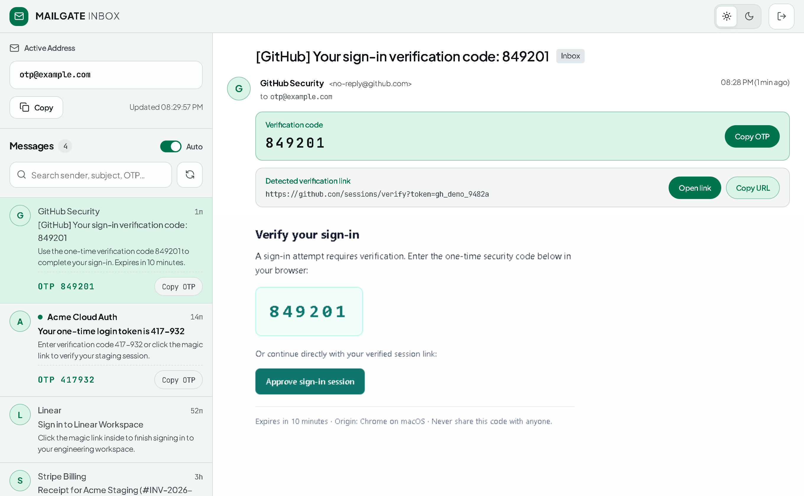

# MailGate

**Self-hosted, receive-only email & OTP inbox on Cloudflare Workers + D1 + Email Routing.**

Stop paying \$29–\$99/mo for hosted QA email sandboxes or spinning up disposable SMTP servers. MailGate turns any custom domain on Cloudflare into an instant, allowlist-controlled inbox viewer with automatic OTP/magic-link extraction, sandboxed HTML rendering, and a zero-dependency E2E testing SDK (`waitForOtp()` / `waitForEmail()`).



---

## Why MailGate?

| Capability | MailGate (Self-Hosted) | Hosted QA Sandboxes (Mailosaur / Mailtrap) | Public Temp Mail (Mailinator) |
| --- | --- | --- | --- |
| **Hosting Cost** | **\$0/mo** (Cloudflare Free Tier) | \$15 – \$99+/mo | Free (public) / Paid (private) |
| **Custom Domain (`*@yourdomain.com`)** | Built-in via Cloudflare Email Routing | Paid tiers | Paid tiers |
| **Private / Password-Protected Inboxes** | Strict allowlist + per-inbox PBKDF2 passwords | Yes | Public by default |
| **OTP & Magic-Link API (`waitForOtp`)** | Built-in `/api/inbox/latest-otp` + `@mailgate/sdk` | Yes | Paid tiers |
| **Zero Server Maintenance** | Edge Worker + D1 SQLite + Cron cleanup | Managed | Managed |
| **Data Ownership** | 100% inside your Cloudflare account | Third-party cloud | Public / Third-party |

## Architecture

```mermaid
flowchart LR
  Sender["Auth Provider / App<br/>(OTP, Magic Link, Receipt)"] -->|SMTP| CF["Cloudflare Email Routing<br/>(*@example.com)"]
  CF -->|email() handler| Worker["MailGate Worker<br/>(postal-mime + sanitizer + OTP extractor)"]
  Worker -->|Strict allowlist check| D1[("Cloudflare D1<br/>SQLite")]
  Cron["Daily Cron Trigger<br/>(03:00 UTC)"] -->|Purge expired mail| D1
  Browser["Web Inbox & Admin UI<br/>(Sandboxed iframe + Light/Dark)"] <-->|HTTPS JSON API| Worker
  E2E["Playwright / Cypress / CI<br/>(@mailgate/sdk)"] <-->|GET /api/inbox/latest-otp| Worker
```

---

## Key Features

- **Receive-Only by Design**: Zero outbound SMTP relay, zero spam-abuse surface, zero VPS to patch.
- **Strict Allowlist + Optional Passwords**: Reject unknown recipients at the SMTP edge (`STRICT_ALLOWLIST = "true"`). Lock sensitive inboxes with PBKDF2-SHA256 (100,000 iterations) passwords and signed HMAC-SHA256 tokens.
- **Smart OTP & Magic-Link Extraction**: Automatically extracts 4–8 digit and hyphenated (`417-932`) verification codes plus sign-in links while ignoring calendar-year false positives (`1990–2035`) in invoices and footers.
- **E2E Automation Ready**: Dedicated `GET /api/inbox/latest-otp` endpoint (`since` + `sender` filters) paired with the zero-dependency [`@mailgate/sdk`](./sdk/README.md) (`waitForOtp()`, `waitForEmail()`).
- **Defense-in-Depth Email Rendering**: Server-side HTML sanitization on ingest **plus** sandboxed `<iframe sandbox="allow-popups allow-popups-to-escape-sandbox">` rendering and strict CSP (`script-src 'self'`).
- **Built-in RFC822 Simulator & Admin Panel**: Test the real `PostalMime → Sanitizer → OTP → D1` pipeline locally without waiting for external SMTP delivery, export CSVs, and purge inboxes in one click.
- **Optional Webhook Bridge**: Prefer Postgres, MySQL, or your own backend? Deploy [`cloudflare-bridge/`](./cloudflare-bridge/README.md) to forward HMAC-SHA256 signed JSON webhooks instead of using D1.

---

## 5-Minute Quickstart

### 1. Local Development

```bash
git clone https://github.com/Dicka18/mailgate.git
cd mailgate
npm install
cp .dev.vars.example .dev.vars
```

Run local D1 migrations, load demo OTP messages, and start Wrangler:

```bash
npm run db:migrate:local
npm run db:seed:local
npm run dev
```

Open `http://localhost:8787`:
- Enter `otp@example.com` (open inbox — no password needed) to inspect the demo messages.
- Sign in using the `ADMIN_EMAIL` and `ADMIN_TOKEN` from `.dev.vars` to access the Admin Panel (`Allowed Inboxes`, `Email Simulator`, and `Recent Messages`).

### 2. Production Deployment on Cloudflare

```bash
# 1. Create the D1 database and copy the returned database_id into wrangler.toml
npx wrangler d1 create mailgate-db

# 2. Apply schema to production D1
npm run db:migrate:remote

# 3. Set production secrets
npx wrangler secret put ADMIN_EMAIL
npx wrangler secret put ADMIN_TOKEN
npx wrangler secret put SESSION_SECRET

# 4. Deploy Worker + static Web UI
npm run deploy
```

Finally, enable **Cloudflare Email Routing** on your domain:
1. Open Cloudflare Dashboard → **Email** → **Email Routing**.
2. Go to **Routing rules** → **Catch-all address** → Edit.
3. Set Action to **Send to a Worker** and select **`mailgate`**.

---

## Playwright / CI E2E Testing (`@mailgate/sdk`)

Use the zero-dependency SDK in [`./sdk`](./sdk/README.md) to eliminate flaky sleeps and third-party sandbox fees in your auth tests:

```ts
import { test, expect } from '@playwright/test';
import { MailGateClient } from './sdk/index.mjs'; // or '@mailgate/sdk'

const mailgate = new MailGateClient({
  baseUrl: process.env.MAILGATE_URL!,
  adminToken: process.env.MAILGATE_ADMIN_TOKEN,
});

test('user can sign in via email OTP', async ({ page }) => {
  const email = 'e2e-auth@example.com';
  const startedAt = new Date();

  await page.goto('/login');
  await page.getByLabel('Email').fill(email);
  await page.getByRole('button', { name: 'Send verification code' }).click();

  const { otpCode } = await mailgate.waitForOtp({
    email,
    since: startedAt,
    sender: 'no-reply@yourapp.com',
    timeoutMs: 30_000,
  });

  await page.getByLabel('Code').fill(otpCode);
  await page.getByRole('button', { name: 'Verify' }).click();
  await expect(page).toHaveURL('/dashboard');
});
```

---

## REST API Overview

| Method | Endpoint | Description |
| --- | --- | --- |
| `GET` | `/api/health` | Service health check for CI `wait-on` and uptime monitors |
| `GET` | `/api/config` | Public domain and strict-allowlist mode metadata |
| `POST` | `/api/inbox/check` | Check whether an email address is allowlisted and password-locked |
| `POST` | `/api/inbox/open` | Authenticate an inbox (or admin account) and issue a signed `X-Inbox-Token` |
| `GET` | `/api/inbox/messages` | List messages (`?email=&since=&sender=&limit=`) |
| `GET` | `/api/inbox/latest-otp` | Return the newest extracted `otpCode` + `verificationLink` (`?email=&since=&sender=`) |
| `GET` | `/api/inbox/messages/:id` | Read full sanitized HTML/text body and mark message as read |
| `GET/POST` | `/api/admin/inboxes` | List or create allowlisted inboxes (`X-Admin-Token` or admin cookie) |
| `PATCH/DELETE` | `/api/admin/inboxes/:id` | Update label/status/password or delete inbox (`?delete_messages=true`) |
| `GET/DELETE` | `/api/admin/messages` | Inspect latest stored messages or purge by `?email=` |
| `POST` | `/api/admin/simulate` | Inject a simulated RFC822 email through the full ingest & OTP pipeline |

---

## Configuration (`wrangler.toml`)

| Variable | Default | Purpose |
| --- | --- | --- |
| `MAIL_DOMAIN` | `example.com` | Primary domain displayed in UI placeholders and Admin Panel |
| `STRICT_ALLOWLIST` | `"true"` | When `"true"`, rejects non-allowlisted recipients at SMTP ingest |
| `RETENTION_DAYS` | `"14"` | Daily Cron Trigger purges messages older than N days (`0` disables cleanup) |
| `ALLOW_SIMULATE` | `"true"` | Enables `POST /api/admin/simulate` (set `"false"` in locked-down production) |

Secrets (via `wrangler secret put` or local `.dev.vars`):
- `ADMIN_EMAIL` — Admin login email for stealth login via the main form
- `ADMIN_TOKEN` — Admin password & `X-Admin-Token` header credential
- `SESSION_SECRET` — Random 32+ byte secret used to sign HMAC-SHA256 session cookies and inbox tokens

---

## Security & Testing

```bash
npm run typecheck   # Strict TypeScript verification
npm test            # Unit tests (OTP, HTML sanitizer, PBKDF2/HMAC crypto, ingest, & SDK)
```

See [SECURITY.md](./SECURITY.md) for the security architecture and responsible disclosure process, and [CONTRIBUTING.md](./CONTRIBUTING.md) to get involved.

## License

Released under the [MIT License](./LICENSE).
